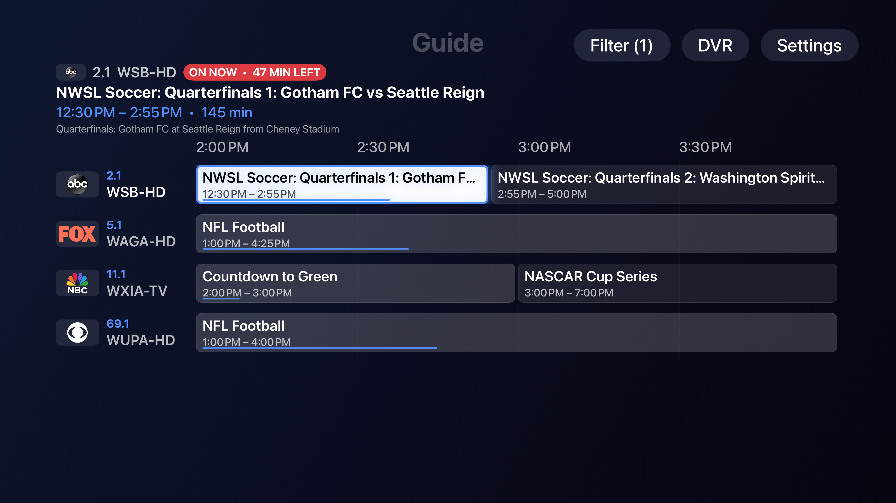
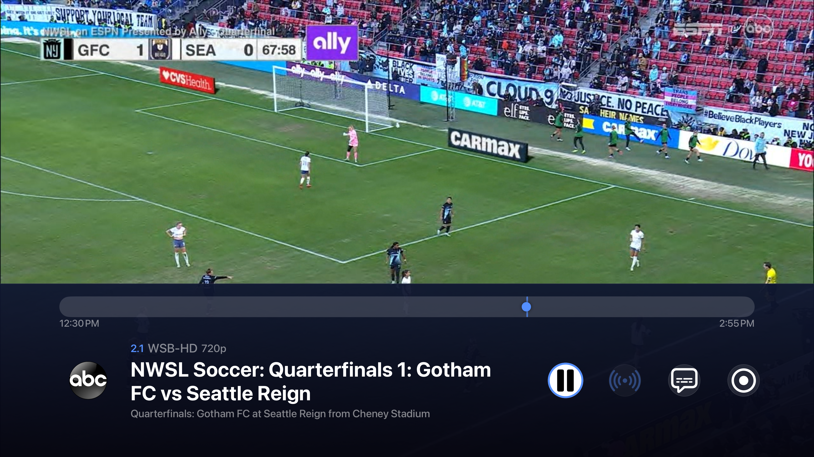
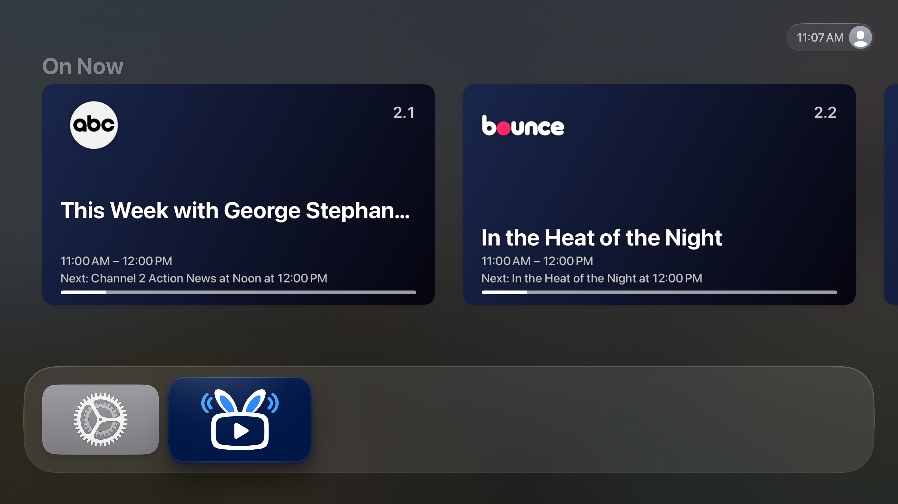
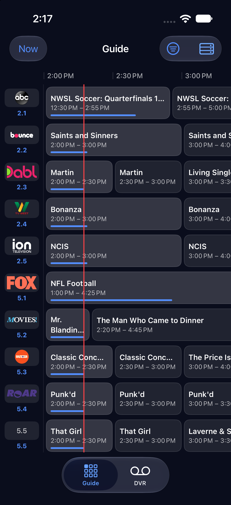
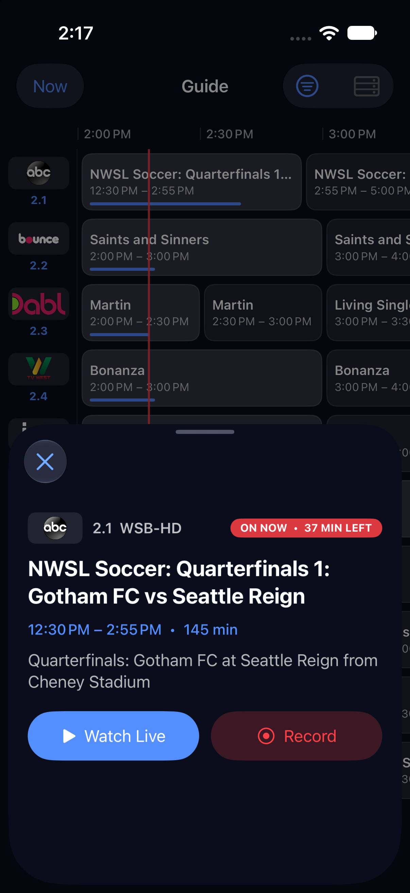
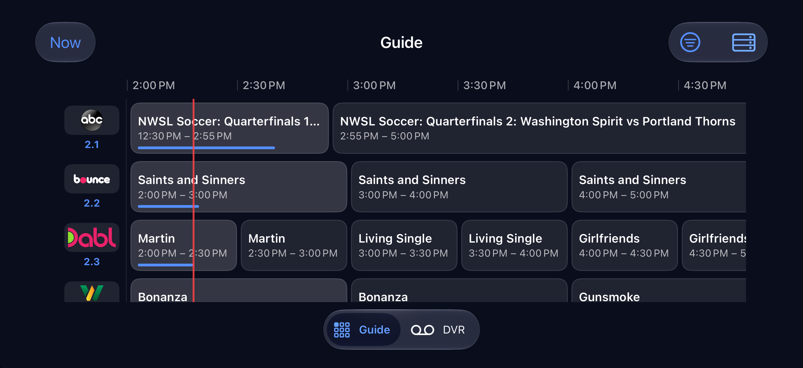
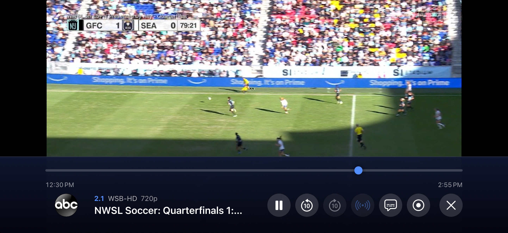

# Rabbit Ears

A native Apple TV app (with an iPhone/iPad companion) for watching and recording live TV from a [Tvheadend](https://tvheadend.org) server.

### Apple TV

#### Guide


#### Live View


#### Top Shef Tiles


### iPhone

#### Guide
 

#### Guide Landscape


#### Live View


## TBA
App store submission

## What it does

- **Guide**: a channel grid showing what's on now and next, with a channel filter. Pick a program to watch it live or set it to record.
- **Live TV**: pause and rewind live TV, captions, and a record button in the player. Programs that are already recording can be watched from the beginning, with the whole recording available to rewind through.
- **DVR**: browse, play, stop and delete recordings on the server.
- **Playback** uses [AetherEngine](https://github.com/superuser404notfound/AetherEngine), which decodes the MPEG-2 video common in broadcast TV in software. Apple's own video player can't decode MPEG-2.

## Requirements

- A Tvheadend server reachable from your network. The app asks for its address and login on first launch.
- Xcode 27, tvOS 27 or later, iOS 18 or later.

## Building

```sh
make run        # build, install and launch on an Apple TV or tvOS simulator you pick
make run-ios    # the same for an iPhone/iPad or iOS simulator
make help       # every target
```

The project is `AppleTV/RabbitEars/RabbitEars.xcodeproj`. The first build downloads AetherEngine and its FFmpeg binaries, which takes a few minutes.
